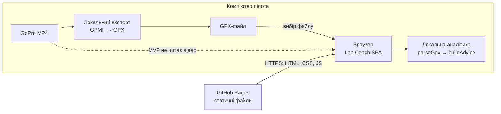

# System Architecture and Development Tooling

> **Поточний стан MVP:** Lap Coach — клієнтський вебзастосунок без власного бекенду та бази даних. GPX обробляється в браузері, дані сесії залишаються на комп'ютері пілота. Це відповідає обіцянці Product Map щодо приватності та обмеженню бюджету — 0.

## Архітектурні рішення

### 1. Клієнтський застосунок без бекенду

**Рішення:** статичні файли застосунку розміщуються на GitHub Pages, імпорт GPX та аналітика виконуються локально в браузері. **Альтернатива:** сервер, який приймає відео й обробляє телеметрію. **Чому так:** локальна обробка не передає файли пілота на сервер, а безкоштовний GitHub Pages усуває витрати на серверну інфраструктуру. Серверна обробка потребувала б сховища великих відео, трафіку й обчислювальних ресурсів.

### 2. GPX як вхідний формат

**Рішення:** MVP приймає GPX, експортований із GPS-телеметрії GoPro. `gopro-telemetry` перетворює витягнуті з MP4 GPMF-дані на GPX; застосунок отримує вже готовий файл із координатами й часом. **Альтернатива:** читати MP4 безпосередньо в браузері. **Чому так:** GPX — відкритий формат; тестовий файл має розмір близько 2,6 МБ замість гігабайтів відео. Той самий парсер підійде для треків із телефона в майбутній бета-версії. Читання MP4 у браузері заплановане після етапу 4. [Документація `gopro-telemetry`](https://www.npmjs.com/package/gopro-telemetry).

### 3. Аналітика — ланцюжок чистих функцій

**Рішення:** аналіз розділено на послідовні кроки:

```text
parseGpx → buildSession → splitLaps → filterLaps → analyzeCorners → sortByLoss → buildAdvice
```

**Альтернатива:** один великий модуль, який читає файл, виділяє кола й формує рекомендації. **Чому так:** незалежні функції простіше тестувати та замінювати поетапно: зміна алгоритму кіл не потребує переписування парсера або формування порад. Типи з `app/src/model.ts` задають спільний контракт між кроками.

### 4. Локальні координати та відстань уздовж кола

**Рішення:** GPS-координати переводяться в локальні метри: центр лінії старту/фінішу — `(0, 0)`, `x` — на схід, `y` — на північ. Повороти задаються відстанями `startM`, `apexM`, `endM` від лінії старту вздовж кола. **Альтернатива:** аналізувати широту/довготу або зберігати повороти лише як географічні координати. **Чому так:** локальні метри спрощують геометрію, а відстань уздовж кола розрізняє ділянки, які просторово накладаються одна на одну, наприклад на мосту.

### 5. Розрахунок швидкості

**Рішення:** швидкість обчислюється з відстані між сусідніми координатами та різниці часових міток; результат у км/год згладжується у вікні ±3 точки. **Альтернатива:** покладатися на готове поле швидкості або використовувати незгладжені значення. **Чому так:** вхідний контракт аналізатора спирається на координати й час, а швидкість обчислюється незалежно від додаткових полів джерела. Згладжування зменшує GPS-шум; під час ручної перевірки мінімальні швидкості в поворотах збігалися з оцінкою приблизно в межах 1 км/год.

## Інструменти розробки

- **TypeScript** — типи в `app/src/model.ts` є спільним контрактом між модулями й учасницями команди.
- **Vite** — забезпечує швидкий цикл локальної розробки та збирає застосунок у статичні файли.
- **Vitest + jsdom** — виконують модульні й інтеграційні тести; jsdom надає DOM-середовище, зокрема `DOMParser`, для тестування розбору GPX.
- **GitHub Actions** — автоматично запускає перевірки, тести та збирання під час push і pull request.
- **GitHub Pages** — безкоштовно публікує статичну збірку MVP.
- **TypeDoc** — генерує API-документацію з TypeScript-коду та коментарів.
- **Mermaid** — дає змогу зберігати діаграми безпосередньо в Markdown, де їх відображає GitHub.
- **Jira + GitHub** — Jira відстежує задачі, а GitHub забезпечує контроль версій, гілки та pull request.

## Діаграма розгортання MVP



У MVP відео використовується лише для локального експорту GPX; застосунок читає вибраний GPX і виконує обробку в браузері. Передавання GPX або MP4 на сервер не передбачене.

## Перехід до Релізу 1.0

У Релізі 1.0 планується читання MP4 у браузері, сервер для акаунтів та історії прогресу й база даних для збереження сесій і результатів (див. [Data-Model.md](./Data-Model.md)). Отже, на сервер передаватимуться дані акаунта та збережені результати/метадані сесій. MP4 і GPX доцільно й надалі обробляти локально, не завантажуючи їх без окремої потреби та згоди користувача. Тому обіцянку приватності Релізу 1.0 слід уточнити: медіафайли залишаються на пристрої, а дані акаунта й історії зберігаються сервером.
