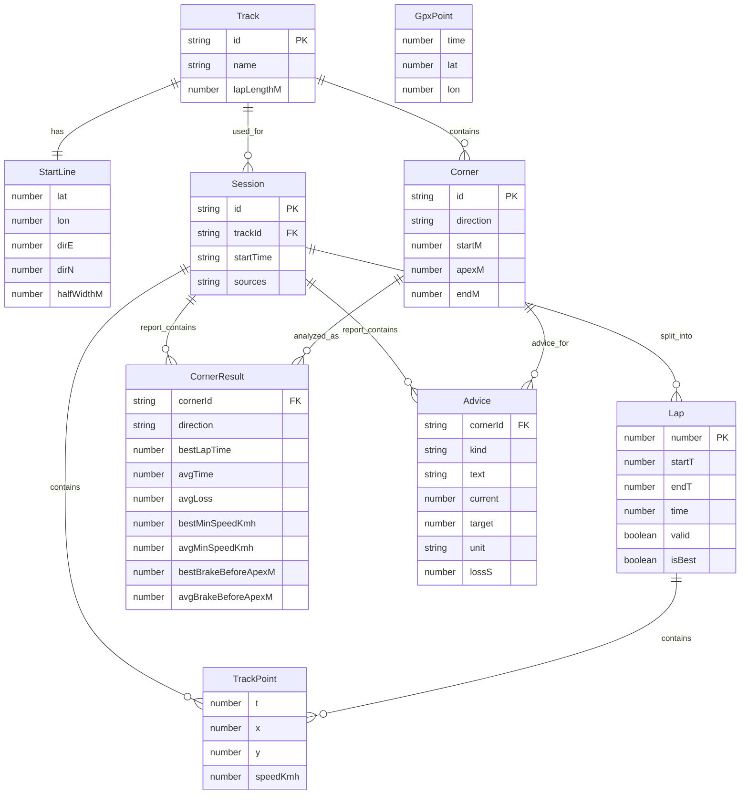
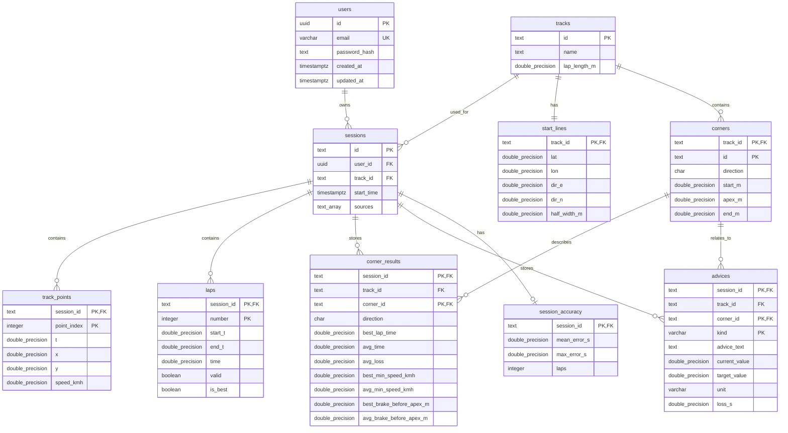

# Data Model

**Поточний стан MVP:** серверної частини та бази даних у MVP немає — дані сесії зберігаються лише в пам'яті браузера. Тому нижче наведено дві моделі: логічну модель даних, що відповідає контрактам `app/src/model.ts`, і запропоновану фізичну схему PostgreSQL для **Релізу 1.0**, у якому з'являться облікові записи користувачів та збереження історії заїздів і результатів.

## 1. Логічна модель даних (MVP)

Логічна модель описує об'єкти, якими обмінюються модулі застосунку. Сутність `Track` відповідає інтерфейсу `TrackConfig` у `app/src/model.ts`; назви та поля в діаграмі відповідають контракту. Типи `number`, `string` і `boolean` відповідають типам TypeScript.

`GpxPoint` — проміжна точка вхідного GPX до перетворення в локальні координати. У поточному контракті вона не є полем `Session`, тому окремого зв'язку з `Session` на діаграмі немає. `TrackPoint` — точка вже перетвореного треку; масив точок належить сесії, а `Lap.points` містить точки відповідного кола.

### Кардинальності та уточнення

- Одна `Session` містить масив `points: TrackPoint[]` і розбивається на `Lap`. `Lap.points: TrackPoint[]` — підмножина точок сесії з інтерпольованими межами кола; обидва масиви показані зв'язками з `TrackPoint` на діаграмі.
- `CornerResult` та `Advice` — елементи звіту конкретної сесії (`Report`) і посилаються на поворот через `cornerId`. Зв'язок із сесією показує вкладеність у `Report`; окремого `sessionId` у цих двох TypeScript-інтерфейсах немає.
- `Corner.id` (`T1`…`T7`) унікальний у межах траси, а не обов'язково глобально. Тому у фізичній схемі його ключ складений: `(track_id, id)`.
- `GpxPoint` не зберігається в `Session`: це вхідний формат (`time`, `lat`, `lon`), з якого обчислюються локальні координати, час від початку сесії та `speedKmh` для `TrackPoint`.

## 2. Фізична схема PostgreSQL — Реліз 1.0

Для Релізу 1.0 пропонується реляційна схема з окремими таблицями для користувачів, конфігурацій трас, сесій та результатів. Імена таблиць і колонок наведено в PostgreSQL-стилі `snake_case`; у застосунку вони мапляться на TypeScript-поля `camelCase` з логічної моделі.

### Опис таблиць і ключів

| Таблиця | Первинний ключ | Зовнішні ключі | Основні поля та типи PostgreSQL |
|---|---|---|---|
| `users` | `id UUID` | — | `email VARCHAR(320) UNIQUE NOT NULL`; `password_hash TEXT NOT NULL`; `created_at`, `updated_at TIMESTAMPTZ NOT NULL`. Пароль зберігається лише у вигляді стійкого хешу. |
| `tracks` | `id TEXT` | — | `name TEXT NOT NULL`; `lap_length_m DOUBLE PRECISION NOT NULL`. Ідентифікатор відповідає `TrackConfig.id`. |
| `start_lines` | `track_id TEXT` | `track_id → tracks.id` | `lat`, `lon`, `dir_e`, `dir_n`, `half_width_m` — `DOUBLE PRECISION NOT NULL`. Один запис на трасу; `track_id` одночасно є PK і FK. |
| `corners` | `(track_id TEXT, id TEXT)` | `track_id → tracks.id` | `direction CHAR(1)` з перевіркою `L`/`R`; `start_m`, `apex_m`, `end_m DOUBLE PRECISION NOT NULL`. Складений ключ дозволяє мати `T1` на різних трасах. |
| `sessions` | `id TEXT` | `user_id → users.id`; `track_id → tracks.id` | `start_time TIMESTAMPTZ NOT NULL`; `sources TEXT[] NOT NULL`. `id`, `track_id`, `start_time`, `sources` відповідають `Session`; `user_id` — нове поле Релізу 1.0. Додати `UNIQUE (id, track_id)` для складених зовнішніх ключів результатів. |
| `track_points` | `(session_id TEXT, point_index INTEGER)` | `session_id → sessions.id` | `t`, `x`, `y`, `speed_kmh DOUBLE PRECISION NOT NULL`. `point_index` — технічний порядковий номер точки, якого немає в `TrackPoint`; він зберігає порядок точок. |
| `laps` | `(session_id TEXT, number INTEGER)` | `session_id → sessions.id` | `start_t`, `end_t`, `time DOUBLE PRECISION NOT NULL`; `valid`, `is_best BOOLEAN NOT NULL`. `points` окремо не дублюються: їх можна відновити з `track_points` за `session_id` і часовими межами кола, додавши інтерпольовані межові точки. |
| `corner_results` | `(session_id TEXT, corner_id TEXT)` | `(session_id, track_id) → sessions(id, track_id)`; `(track_id, corner_id) → corners(track_id, id)` | `track_id` — технічна колонка для перевірки, що поворот належить трасі сесії; вона визначається через `Session.trackId`. Решта полів відповідає `CornerResult`; числові значення — `DOUBLE PRECISION`, `direction CHAR(1)`. |
| `advices` | `(session_id TEXT, corner_id TEXT, kind VARCHAR(32))` | `(session_id, track_id) → sessions(id, track_id)`; `(track_id, corner_id) → corners(track_id, id)` | `track_id` — технічна колонка для зв'язку з поворотом потрібної траси. `advice_text TEXT`, `current_value`, `target_value`, `loss_s DOUBLE PRECISION`, `unit VARCHAR(8)`, `kind VARCHAR(32)` з перевіркою допустимих значень. |
| `session_accuracy` | `session_id TEXT` | `session_id → sessions.id` | `mean_error_s`, `max_error_s DOUBLE PRECISION NOT NULL`; `laps INTEGER NOT NULL`. Таблиця має нуль або один запис на сесію, оскільки `Report.accuracy` необов'язкове. |

> У Mermaid окремі колонки, позначені `PK`, формують складений ключ там, де їх декілька. У SQL-міграції для `corners`, `track_points`, `laps`, `corner_results` та `advices` потрібно явно оголосити відповідні `PRIMARY KEY (...)` і `FOREIGN KEY (...)` обмеження. Для `corner_results` та `advices` також потрібні `UNIQUE (id, track_id)` у `sessions` та `FOREIGN KEY (session_id, track_id) REFERENCES sessions(id, track_id)`, щоб БД не дозволяла зберегти результат для повороту іншої траси.

### Індекси

- `CREATE INDEX sessions_user_id_idx ON sessions(user_id);` — швидке отримання історії заїздів користувача.
- `CREATE INDEX sessions_track_id_idx ON sessions(track_id);` — пошук сесій за трасою та формування статистики траси.
- Первинний ключ `track_points(session_id, point_index)` уже створює індекс для вибірки й упорядкування точок сесії. Для вибірки точок кола за часовим діапазоном додатково: `CREATE INDEX track_points_session_t_idx ON track_points(session_id, t);`.
- Для `users.email` створюється унікальний індекс через обмеження `UNIQUE`.

## 3. Зберігання точок треку

Орієнтир — приблизно **19 000 `TrackPoint` на одну 18-хвилинну сесію**. Для Релізу 1.0 обрано окрему таблицю `track_points`, а не один JSONB-масив у `sessions`.

Причини вибору:

1. Точки можна читати частинами та впорядковано за `point_index`, не завантажуючи весь JSONB-документ.
2. Індекс `(session_id, t)` підтримує ефективний пошук точок у часовому інтервалі кола.
3. Типізовані числові колонки дають змогу виконувати SQL-агрегації та перевірки без розбору JSON.
4. 19 000 рядків на сесію — прийнятний обсяг для PostgreSQL; складений первинний ключ гарантує порядок і відсутність повторного `point_index` у межах сесії.

`Lap.points` не копіюються в окремі рядки: це логічна вибірка з `track_points` між `start_t` і `end_t`. Точки перетину старт-фінішу, час яких інтерполюється, формуються під час читання/побудови звіту. Сирі `GpxPoint` та XML-вміст `GpxFile.text` у цій схемі не зберігаються; `sessions.sources` зберігає лише назви GPX-файлів. Зберігання оригінальних GPX-файлів можна додати окремо, якщо з'явиться вимога повторного імпорту або аудиту.

## 4. Що вже є в MVP

| Можливість / сутність | Є в MVP? | Пояснення |
|---|---|---|
| TypeScript-контракти `TrackConfig`, `StartLine`, `Corner` | Так | Описані в `app/src/model.ts`; це типи, а не таблиці БД. |
| TypeScript-контракти `Session`, `GpxPoint`, `TrackPoint`, `Lap` | Так | Описані в `app/src/model.ts`; сирі GPX-точки та оброблені точки мають різні типи. |
| TypeScript-контракти `CornerResult`, `Advice`, `Report`, `Accuracy` | Так | Описують структуру результатів аналізу. |
| Зберігання даних сесії в пам'яті браузера | Так | Відповідає поточному стану MVP; після перезавантаження сторінки це не є серверною історією. |
| Облікові записи (`users`) та авторизація | Ні | Заплановано для Релізу 1.0. |
| Серверна PostgreSQL БД і постійне збереження сесій | Ні | У MVP серверної частини та БД немає. |
| Прив'язка сесії до користувача (`sessions.user_id`) | Ні | Нова можливість Релізу 1.0. |
| Постійне збереження кіл, точок і результатів поворотів/порад | Ні | У фізичній схемі Релізу 1.0 це `laps`, `track_points`, `corner_results` та `advices`. |
| Індекси БД для `user_id` і `track_id` | Ні | Будуть створені разом із PostgreSQL-схемою Релізу 1.0. |
