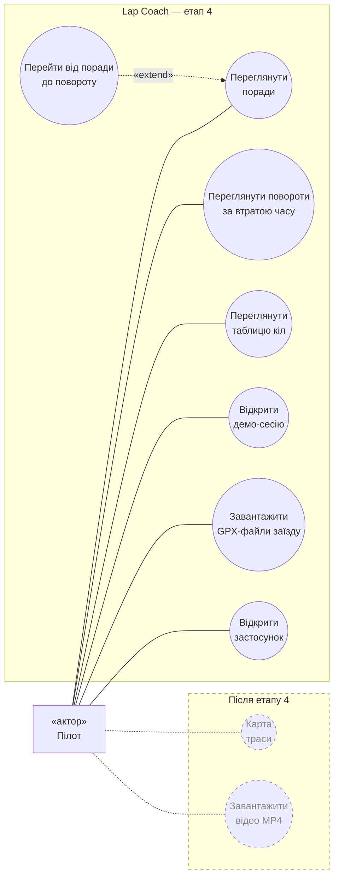
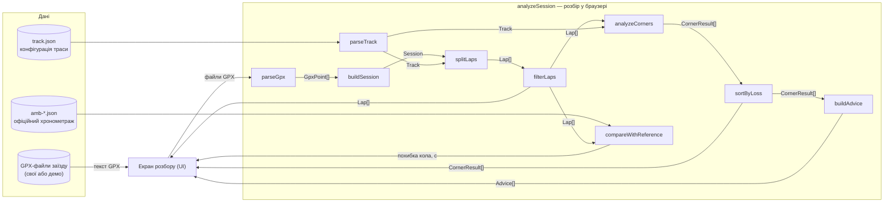

# UML: модель системи Lap Coach

Дві діаграми MVP: що пілот робить у застосунку (прецеденти) і з яких модулів складається розбір заїзду (компоненти).

---

## 1. Діаграма прецедентів

Пілот відкриває застосунок і дає йому заїзд одним із двох способів: завантажує свої GPX-файли або відкриває демо-сесію «Жаги швидкості». Після цього він бачить три частини одного екрана розбору: таблицю кіл, повороти, відсортовані за втраченим часом, і поради. Перехід від поради до повороту розширює перегляд порад («extend»). Завантаження відео MP4 і карта траси позначені пунктиром: їх робимо після етапу 4.

## 2. Діаграма компонентів

Екран розбору передає GPX-файли в `analyzeSession` — конвеєр, який повністю працює в браузері, без сервера (B-18). `parseGpx` і `buildSession` збирають точки з усіх файлів в одну сесію; `splitLaps` ділить її на кола за лінією старту/фінішу з `track.json`, `filterLaps` відкидає виїзне коло, а `analyzeCorners`, `sortByLoss` і `buildAdvice` рахують втрати в поворотах і поради. Назад на екран ідуть три результати — `Lap[]`, `CornerResult[]` і `Advice[]`, а `compareWithReference` порівнює кола з `amb-*.json` і показує похибку проти офіційного хронометражу (ціль — ≤ 0,05 с, B-21).
